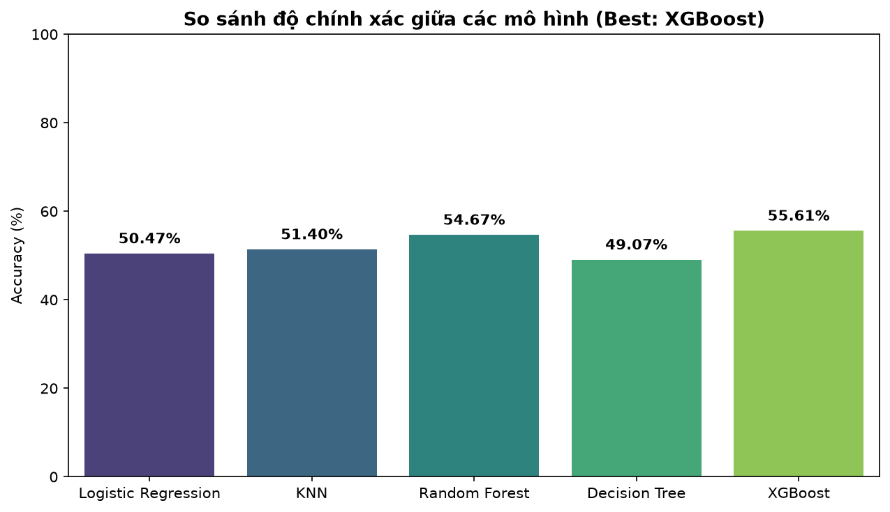

`# ⚽ FiFaWorldCup-1930-2026 — Dự Đoán Kết Quả FIFA World Cup với Machine Learning


Dự án áp dụng các kỹ thuật học máy (**Machine Learning Pipeline**) để phân tích tập dữ liệu lịch sử các kỳ **FIFA World Cup từ năm 1930 đến 2026** (1.069 trận đấu). Mục tiêu là xây dựng quy trình tiền xử lý chống rò rỉ dữ liệu (`ColumnTransformer` + `OneHotEncoder` + `StandardScaler`), huấn luyện, đánh giá và triển khai dự đoán trực tiếp trên Terminal lẫn Giao diện Web (Frontend + Backend + SQLite Database) cho 2 bài toán chính:

1. **Hồi quy (Regression):** Dự đoán số bàn thắng kỳ vọng (`xG` - Expected Goals) của hai đội bóng (`total_goals_team1`, `total_goals_team2`).
2. **Phân loại đa lớp (Multi-class Classification):** Dự đoán kết quả trận đấu giữa hai đội bóng: **Thắng (2)**, **Hòa (1)**, hoặc **Thua (0)**.

---

## 📁 Cấu trúc thư mục dự án

```text
Fifaworldcup_ML/
│
├── Data/
│   └── fifa.csv                     # Tập dữ liệu lịch sử World Cup (1930 - 2026)
│
├── Models/                          # Thư mục chứa các module thuật toán & Pipeline
│   ├── __init__.py                  # Đánh dấu package Python
│   ├── preprocessor.py              # Feature Engineering & ColumnTransformer (OneHotEncoder + Scaler)
│   ├── Linear_regression.py         # Hồi quy tuyến tính (Ridge Pipeline) dự đoán số bàn thắng
│   ├── Logistic_regression.py       # Hồi quy Logistic phân loại kết quả
│   ├── knn.py                       # K-Nearest Neighbors Pipeline
│   ├── Decision_tree.py             # Cây quyết định (Decision Tree Pipeline)
│   ├── Random_forest.py             # Rừng ngẫu nhiên (Random Forest Pipeline)
│   └── Xgboost.py                   # Thuật toán phân loại XGBoost Pipeline
│
├── UI/                              # Ứng dụng Web (Frontend + Backend + SQLite Database)
│   ├── app.py                       # Flask Backend REST API & Web Server
│   ├── database.py                  # Quản lý kết nối và truy vấn SQLite
│   ├── worldcup.db                  # Cơ sở dữ liệu SQLite (lịch sử trận đấu, metrics & lịch sử dự đoán)
│   ├── templates/
│   │   └── index.html               # Giao diện FIFA World Cup 2026™ Predictor & Group Stage Board
│   └── static/
│       ├── css/style.css            # Thiết kế giao diện Stadium Floodlights, Neon Poster & Ảnh nền 2026
│       ├── js/app.js                # Xử lý tương tác Bảng đấu A-L, biểu đồ xác suất & truy vấn DB
│       └── images/                  # Tài nguyên hình ảnh giao diện World Cup 2026
│           ├── wc2026_bg.jpg        # Ảnh nền trái bóng FIFA World Cup 2026 trên sân cỏ
│           ├── wc2026_groups.png    # Poster mẫu 12 bảng đấu World Cup 2026 (A - L)
│           ├── wc_stadium_hero.png  # Ảnh Cúp Vàng Thế Giới & đèn pha sân vận động
│           └── trophy_center.png    # Ảnh Cúp Vàng trung tâm bảng đấu
│
├── saved_models/                    # Lưu trữ Pipeline mô hình tối ưu nhất (.pkl)
│   ├── best_model.pkl               # Pipeline(Preprocessor + Best Model) tự động chọn
│   └── model_bundle.pkl             # Gói toàn bộ 5 mô hình + mô hình dự đoán bàn thắng
│
├── Main.py                          # File thực thi huấn luyện & đánh giá chính (Main Pipeline)
├── predict.py                       # Script dự đoán kết quả cặp đấu bất kỳ ngay trên Terminal
├── model_comparison.png             # Biểu đồ so sánh độ chính xác giữa các model
├── Readme.md                        # Tài liệu hướng dẫn dự án
├── requirements.txt                 # Danh sách các thư viện phụ thuộc
└── .gitignore                       # Cấu hình bỏ qua file rác khi đẩy Git
```

---

## 📊 Kết quả so sánh (Results)

Dưới đây là biểu đồ so sánh độ chính xác (**Accuracy**) giữa các mô hình phân loại sau khi chuẩn hóa dữ liệu lịch sử và đóng gói `Pipeline` chống rò rỉ dữ liệu (Data Leakage):



### 📌 Nhận xét mô hình
- 🥇 **Mạnh nhất — XGBoost (~55.61%):** Học tuần tự kết hợp điều chuẩn (`reg_lambda`, `subsample`), xử lý xuất sắc dữ liệu đặc trưng bóng đá và được hệ thống **tự động chọn lưu** vào `saved_models/best_model.pkl`.
- 🥈 **Cân bằng nhất — Random Forest (~54.67%):** Điểm số bám sát XGBoost, hoạt động ổn định và chống quá khớp tốt.
- 🥉 **KNN (~51.40%) & Logistic Regression (~50.47%):** Cho kết quả khả quan khi dữ liệu được chuẩn hóa qua `StandardScaler` trong Pipeline.
- ⚠️ **Yếu nhất — Decision Tree (~49.07%):** Cây đơn lẻ dễ bị Overfitting trên tập dữ liệu lịch sử nhiều biến phân loại.

> **Kết luận:** Trong bài toán phân loại 3 lớp bóng đá (Thắng / Hòa / Thua — xác suất ngẫu nhiên là `33.3%`), việc đạt độ chính xác thực tế **~55% – 56%** (không rò rỉ dữ liệu) cùng khả năng ước lượng xác suất hợp lý là nền tảng vững chắc để triển khai ứng dụng dự đoán.

---

## ⚙️ Hướng dẫn cài đặt và sử dụng (How to Run)

### 1. Clone repository & Cài đặt thư viện
```bash
git clone https://github.com/VoHoQuocAnh/Fifaworldcup_ML.git
cd Fifaworldcup_ML
pip install -r requirements.txt
```

### 2. Huấn luyện mô hình và tự động lưu `best_model.pkl`
```bash
python Main.py
```

### 3. Dự đoán cặp đấu bất kỳ trên Terminal (`predict.py`)
- **Chế độ nhập tương tác trực tiếp:**
  ```bash
  python predict.py
  ```
- **Chế độ truyền tham số nhanh qua CLI:**
  ```bash
  python predict.py --team1 "Argentina" --team2 "France" --stage "Final" --year 2026
  ```

### 4. Khởi chạy Giao diện Web & Cơ sở dữ liệu (`UI/`)
```bash
python UI/app.py
```
Sau đó mở trình duyệt truy cập: **http://127.0.0.1:5000**

---

## 👤 Tác giả (Author)
- **Họ và tên:** Võ Hồ Quốc Anh
- **Email:** vohoquocnanh2024@gmail.com
